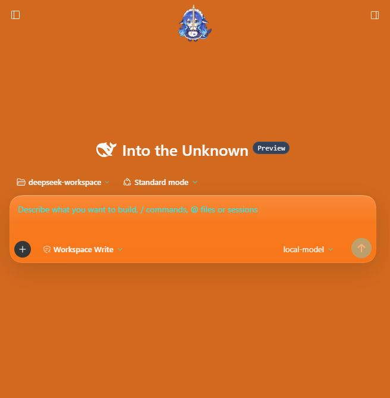
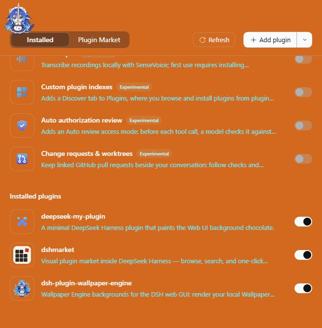
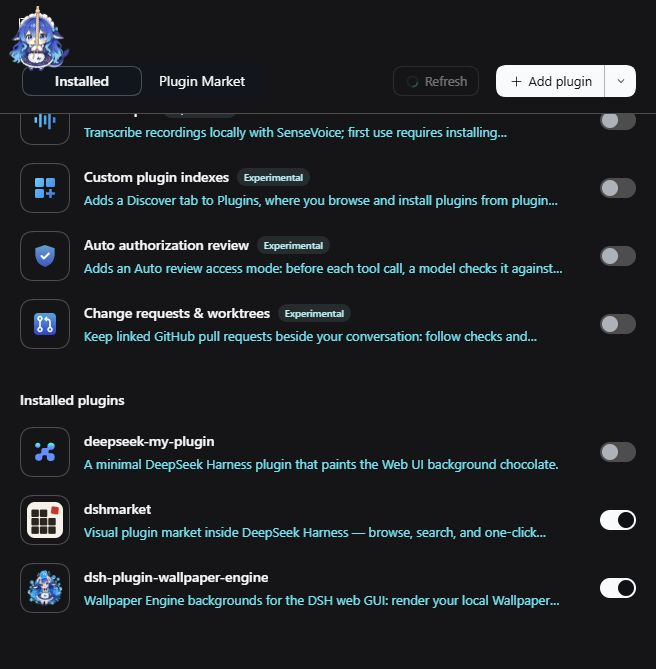

# deepseek-my-plugin

A minimal [DeepSeek Harness](https://github.com/deepseek-ai/deepseek-harness) plugin.
While it is installed, the Web UI background is `chocolate` (`#D2691E`).

**한국어 튜토리얼:** [TUTORIAL.md](./TUTORIAL.md) — 처음부터 다시 만들면서
플러그인 구조와 작성 방법을 익히는 단계별 가이드입니다.

## Screenshots

The Web UI with the plugin enabled:



With the plugin installed, **Plugins** shows an enabled entry. Toggling it off
restores the normal theme immediately, without uninstalling:

| Enabled | Disabled |
| --- | --- |
|  |  |

## Layout

```
deepseek-my-plugin/
├── package.json       # dsh.bundle + dsh.client manifests
├── cordis.patch.yml   # the Loader row this bundle contributes
├── src/
│   ├── index.ts       # host half (empty apply; makes the Loader row real)
│   └── client/
│       └── index.ts   # browser half (the theme override)
└── tsdown.config.ts   # host ESM entry + browser factory bundle
```

## How it works

The host half does nothing. Installing the bundle inserts a Loader row whose
name is the bare package name. The client module system scans enabled rows,
sees the package's `dsh.client` declaration, and serves `exports["./client"]`
to the browser.

The browser half waits for the `theme` service and calls
`ctx.theme.overrideTokens()`:

```ts
ctx.theme.overrideTokens('deepseek-my-plugin', {
  '--dsw-alias-bg-base': { light: 'chocolate', dark: 'chocolate' },
})
```

That stacks a token layer over the active light/dark palette. Uninstalling or
disabling the plugin removes the layer and restores the normal background.

## Build

```sh
pnpm install
pnpm run typecheck
pnpm run build
```

The built artifacts are committed under `lib/`, so a local install needs no
build step. The plugin can live anywhere on disk; it only needs the harness at
runtime.

## Install into a profile

Add the bundle to the Web profile. Pass the path to this directory (relative or
absolute), wherever you keep it:

```sh
dsh plugin --profile web add ../deepseek-my-plugins-project/deepseek-my-plugin
dsh web
```

The install is a pnpm link to this directory, so if you move the directory,
remove and re-add the plugin.

Then open the Web UI. The background is chocolate. To remove the plugin:

```sh
dsh plugin --profile web remove deepseek-my-plugin
```

## Extend it

- Change `BACKGROUND_COLOR` in `src/client/index.ts` to any CSS colour.
- Add more theme tokens to the same `overrideTokens` call (each needs both
  `light` and `dark` values).
- Add host-side behaviour in `src/index.ts` (tools, services, events).
