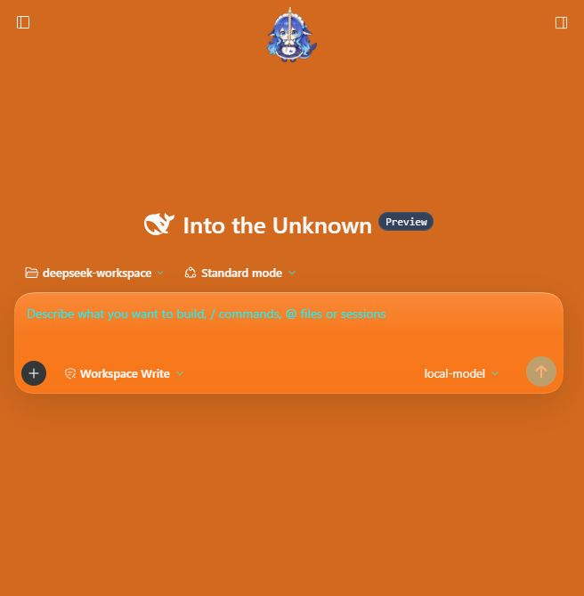
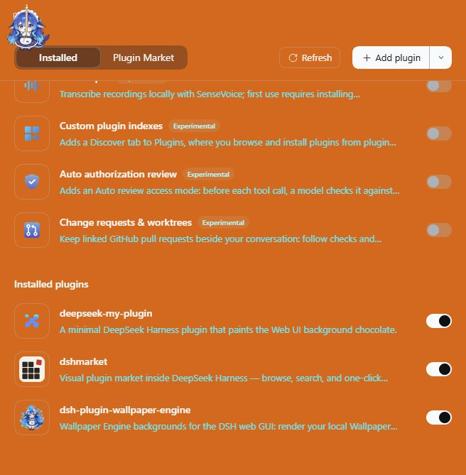
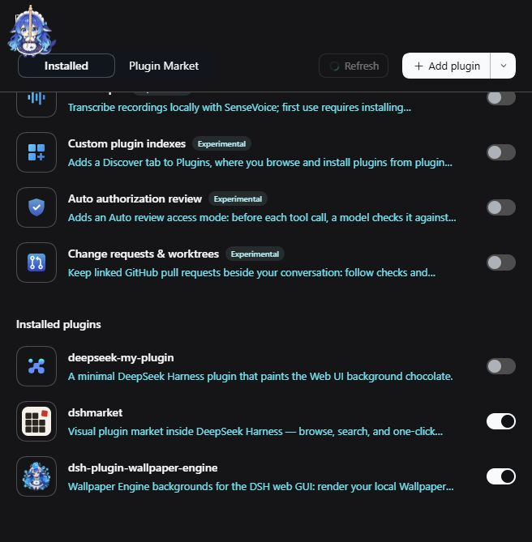

# 나만의 DeepSeek Harness 플러그인 만들기

이 문서는 `deepseek-my-plugin`을 처음부터 다시 만들면서 DeepSeek Harness
플러그인의 구조와 작성 방법을 익히는 튜토리얼입니다.

더 깊은 내용은 네 문서로 이어집니다.

- [docs/CORDIS.md](./docs/CORDIS.md) — Cordis 프레임워크 자체의 구조와 사용법
  (Context·plugin·fiber·effect, 서비스/이벤트, 조합, 설정, 진단)
- [docs/ARCHITECTURE.md](./docs/ARCHITECTURE.md) — 런타임 지형, 레이어 합성,
  Host/Client 수명주기, 모듈 로더, 슬롯, 테마 토큰
- [docs/IMPLEMENTATION-GUIDE.md](./docs/IMPLEMENTATION-GUIDE.md) — 도구·서비스·
  설정·UI·커맨드·라우트 레시피와 패키징/디버깅 체크리스트
- [docs/PLUGIN_MODEL.md](./docs/PLUGIN_MODEL.md) — 에이전트 코어와 플러그인의
  통신 모델, Cordis의 역할, 턴/스텝·툴 파이프라인 개입 지점

최종 결과는 아주 작습니다. 플러그인이 설치되어 있는 동안 Web UI의 기본
배경색이 **chocolate**(`#D2691E`)이 됩니다.

---

## 0. 먼저 알아둘 개념

DeepSeek Harness(`dsh`)는 "모든 것이 플러그인"인 구조입니다. 이 튜토리얼에서
만드는 플러그인은 두 개의 절반으로 이루어집니다.

| 절반 | 실행 위치 | 하는 일 |
| --- | --- | --- |
| Host half | Node.js (dsh 서버) | Loader row를 만들고, 필요하면 도구·서비스·이벤트를 등록 |
| Client half | 브라우저 (Web UI) | 화면을 그리고, 테마 토큰을 덮어씀 |

그리고 패키지는 두 가지 매니페스트를 가집니다.

| 매니페스트 | 의미 |
| --- | --- |
| `dsh.bundle` | "이 패키지가 설치되면 어떤 설정 레이어를 추가하는가" |
| `dsh.client` | "이 패키지의 브라우저 절반은 어디에 있는가" |

로딩 흐름은 다음과 같습니다.

```text
dsh plugin --profile web add ./deepseek-my-plugin
        │
        ▼
profile의 dsh.profile.bundles에 패키지 추가
        │
        ▼
package.json의 dsh.bundle.patch (cordis.patch.yml) 적용
        │
        ▼
Loader row 추가:  { id: deepseek-my-plugin, name: deepseek-my-plugin }
        │
        ├─ Host half:  package.json main → lib/index.js
        └─ Client half: dsh.client + exports["./client"] → lib/client.js
```

중요한 점은 **client half가 붙는 조건**입니다. 브라우저 절반은 Loader row의
`name`이 **하위 경로가 아닌 패키지 이름 그대로**일 때 그 row에 붙습니다.
그래서 `cordis.patch.yml`에서 `name: deepseek-my-plugin`처럼 씁니다.

---

## 1. 준비

플러그인을 빌드하는 데 필요한 것은 다음뿐입니다.

- Node.js 24.9 이상
- pnpm

플러그인은 DeepSeek Harness 저장소 **밖에** 두어도 됩니다. 하네스 패키지는
npm에서 타입으로만 가져오고, 런타임에는 하네스가 제공하는 `ctx`를 쓰기
때문입니다.

```text
work/
├── deepseek-harness/                   # 하네스 체크아웃 (dsh 실행/확인용)
└── deepseek-my-plugins-project/
    └── deepseek-my-plugin/             # 플러그인 (여기서 작업)
```

저장소 체크아웃은 `dsh`를 소스에서 실행해 설치·확인을 할 때만 필요합니다.
그 경우 먼저 저장소 루트에서 한 번 빌드해 둡니다.

```sh
pnpm install
pnpm run build
```

> 체크아웃에서 소스로 실행하는 경우, 이 문서의 `dsh ...` 명령은
> `pnpm dsh ...`로 바꿔 실행합니다. 예: `pnpm dsh web`,
> `pnpm dsh plugin --profile web add ../deepseek-my-plugins-project/deepseek-my-plugin`.

---

## 2. `package.json` 작성

`deepseek-my-plugin/package.json`:

```json
{
  "name": "deepseek-my-plugin",
  "version": "0.1.0",
  "description": "A minimal DeepSeek Harness plugin that paints the Web UI background chocolate.",
  "type": "module",
  "main": "lib/index.js",
  "exports": {
    ".": "./lib/index.js",
    "./client": "./lib/client.js",
    "./package.json": "./package.json"
  },
  "files": [
    "lib/index.js",
    "lib/client.js",
    "lib/client.js.map",
    "cordis.patch.yml",
    "TUTORIAL.md"
  ],
  "engines": {
    "dsh": ">=0.2.0 <0.3.0"
  },
  "dsh": {
    "bundle": {
      "patch": "./cordis.patch.yml"
    },
    "client": {
      "platform": "web"
    }
  },
  "scripts": {
    "build": "tsdown",
    "watch": "tsdown --watch"
  },
  "devDependencies": {
    "@deepseek-ai/cordis": "^4.1.0",
    "@deepseek-ai/dsh-client-ui-theme": "0.2.2-rc.1",
    "tsdown": "^0.22.2"
  },
  "license": "MIT"
}
```

각 필드의 역할:

- `name`: 플러그인 ID입니다. Loader row 이름, 브라우저 번들 ID와 같아야 합니다.
- `main` / `exports["."]`: Host half의 진입점입니다.
- `exports["./client"]`: Client half의 진입점입니다. `dsh.client`를 선언하려면
  반드시 있어야 합니다.
- `engines.dsh`: 지원하는 dsh 버전 범위입니다. dsh는 prerelease를 포함해서
  검사하므로 `>=0.2.0 <0.3.0`은 `0.2.2-rc.1`도 만족합니다.
- `dsh.bundle.patch`: 설치 시 적용할 설정 레이어 파일입니다.
- `dsh.client.platform`: 브라우저 플랫폼은 `web`입니다.
- `devDependencies`: 타입과 빌드에만 쓰입니다. 런타임 의존성은 없습니다.

> `@deepseek-ai/dsh-client-ui-theme`는 아직 prerelease(`0.2.2-rc.1`,
> `0.2.2-alpha.3`)로 배포됩니다. semver 범위는 같은 버전의 prerelease를
> 직접 적지 않으면 prerelease를 매칭하지 않습니다. 그래서
> `>=0.2.0 <0.3.0` 같은 범위를 쓰면 `ERR_PNPM_NO_MATCHING_VERSION`이
> 발생하고, 설치된 dsh와 같은 버전을 정확히 고정해야 합니다.
>
> ```sh
> pnpm view @deepseek-ai/dsh-client-ui-theme dist-tags
> # next: 0.2.2-rc.1  ← dsh 0.2.2-rc.1과 맞춤
> ```

> 참고: 이 플러그인의 Host/Client 코드는 `@deepseek-ai/cordis`를 **타입으로만**
> 가져옵니다. 그래서 `peerDependencies`가 필요 없고, 로컬 디렉터리를 링크
> 설치할 때 나는 peer 경고도 생기지 않습니다.

---

## 3. `cordis.patch.yml` 작성

`deepseek-my-plugin/cordis.patch.yml`:

```yaml
# 이 번들이 프로필에 설치될 때 추가하는 레이어.
#
# 패키지 이름 그대로가 Loader row가 된다. client module system은 이 row의
# 패키지 매니페스트에서 dsh.client를 발견하고 exports["./client"]를
# 브라우저에 서빙한다.
- insert:
    - id: deepseek-my-plugin
      name: deepseek-my-plugin
```

`- insert:`는 기존 설정을 교체하지 않고 row를 하나 추가한다는 뜻입니다.
`id`는 설정 안에서 유일하면 되고, `name`은 Node가 resolve할 수 있는 패키지
이름입니다.

---

## 4. Host half 작성

`deepseek-my-plugin/src/index.ts`:

```ts
/**
 * Host half of the plugin.
 *
 * This plugin has no host-side behaviour: it only changes how the Web UI is
 * painted. The empty `apply` still gives the package a Loader row, which is
 * what lets the client module system discover the browser half declared by
 * `dsh.client` in package.json.
 */

/** Host plugin body. Intentionally empty. */
export function apply(): void {}

export const name = 'deepseek-my-plugin'
```

플러그인은 `apply` 함수를 내보내는 것만으로 성립합니다. 프레임워크가 이
함수를 호출할 때 `ctx`를 넘겨주고, 플러그인은 그 `ctx`를 통해 도구, 서비스,
이벤트 리스너, 타이머 등을 등록합니다.

이 플러그인은 화면만 바꾸므로 Host half는 비어 있습니다. 그래도 Host half가
필요한 이유는 **Loader row가 패키지를 로드해야 client module system이 그
패키지의 `dsh.client` 선언을 스캔할 수 있기 때문**입니다.

Host half에서 할 수 있는 일의 예:

```ts
import type { Context } from '@deepseek-ai/cordis'

export const name = 'my-host-plugin'
export const inject = ['tools']

export function apply(ctx: Context): void {
  // ctx.tools.register(...) 같은 등록
}
```

`inject`에 적은 서비스가 준비된 뒤에 `apply`가 호출됩니다.

---

## 5. Client half 작성

`deepseek-my-plugin/src/client/index.ts`:

```ts
/**
 * Browser half of the plugin: paint the Web UI background chocolate.
 *
 * The theme service owns the `--dsw-*` design tokens. `overrideTokens` stacks
 * a token layer over whichever theme is active, so this plugin never replaces
 * the user's light/dark choice — it only overrides the base background while
 * the plugin is loaded, and the layer disappears when the plugin unloads.
 *
 * @module deepseek-my-plugin/client
 */
import type { Context } from '@deepseek-ai/cordis'
// Type-only import: pulls the theme service's Context merge (ctx.theme).
import type {} from '@deepseek-ai/dsh-client-ui-theme/client'

export const name = 'deepseek-my-plugin'

/** Wait until the theme service is ready before applying the override. */
export const inject = ['theme']

/** Application base-background token consumed by the Web UI shell. */
const BACKGROUND_TOKEN = '--dsw-alias-bg-base'

/** CSS named colour #D2691E. */
const BACKGROUND_COLOR = 'chocolate'

/** Layer identity; one override layer per source. */
const OVERRIDE_SOURCE = 'deepseek-my-plugin'

/**
 * Stack one theme override layer that makes the base background chocolate in
 * both palettes.
 * @param ctx - client root context.
 */
export function apply(ctx: Context): void {
  ctx.effect(
    () => ctx.theme.overrideTokens(OVERRIDE_SOURCE, {
      [BACKGROUND_TOKEN]: { light: BACKGROUND_COLOR, dark: BACKGROUND_COLOR },
    }),
    'deepseek-my-plugin: chocolate background',
  )
}
```

핵심 포인트:

1. **`inject = ['theme']`** — `theme` 서비스가 준비될 때까지 기다립니다.
   `ui-theme` 플러그인이 이 서비스를 제공합니다.
2. **`ctx.theme.overrideTokens(source, tokens)`** — 현재 테마 위에 토큰
   레이어를 겹칩니다. 사용자의 라이트/다크 선택을 바꾸지 않습니다.
3. **`{ light, dark }` 쌍** — 토큰 값은 두 팔레트 모두 필수입니다. 같은
   색이라면 같은 값을 반복합니다. 문자열 하나만 넘기면 런타임에서 에러가
   납니다.
4. **`ctx.effect(...)`** — 반환된 disposer를 플러그인 수명에 묶습니다.
   플러그인을 비활성화하거나 제거하면 레이어가 자동으로 사라집니다.

`--dsw-alias-bg-base`는 Web UI 셸이 실제 배경으로 쓰는 기본 토큰입니다.
사이드바까지 같은 색으로 만들고 싶다면 `--dsw-specific-sidebar-fill`을 같은
호출에 추가할 수 있습니다.

---

## 6. 빌드 설정 작성

`deepseek-my-plugin/tsdown.config.ts`:

```ts
import { defineConfig } from 'tsdown'

/** Must match package.json `name`; the client module loader keys bundles by it. */
const ID = 'deepseek-my-plugin'

export default defineConfig([
  {
    name: `${ID}/host`,
    entry: ['src/index.ts'],
    outDir: 'lib',
    format: ['esm'],
    platform: 'node',
    target: 'es2024',
    dts: false,
    clean: true,
    fixedExtension: false,
  },
  {
    name: `${ID}/client`,
    entry: { client: 'src/client/index.ts' },
    outDir: 'lib',
    format: 'cjs',
    platform: 'browser',
    target: 'es2024',
    dts: false,
    clean: false,
    sourcemap: true,
    outputOptions: {
      entryFileNames: 'client.js',
      // The client module system evaluates this file as a factory that returns
      // the plugin module's exports, not as a standalone script.
      banner: `window.__ModuleLoader__.load({ id: ${JSON.stringify(ID)}, factory: (require) => {`,
      footer: 'return module.exports; } });',
      intro: 'var module = { exports: {} }; var exports = module.exports;',
    },
  },
])
```

두 개의 빌드가 있습니다.

- **Host build** — 평범한 ESM입니다. `lib/index.js`가 생성됩니다.
- **Client build** — 브라우저 모듈 로더가 실행하는 factory 형식입니다.
  `banner`/`intro`/`footer`가 CJS 코드를
  `window.__ModuleLoader__.load({ id, factory })` 형태로 감쌉니다.

Client 번들의 `id`는 반드시 `package.json`의 `name`과 같아야 합니다.
모듈 로더가 이 ID로 번들을 찾기 때문입니다.

---

## 7. 빌드하기

플러그인 디렉터리에서:

```sh
pnpm install
pnpm run typecheck
pnpm run build
```

`pnpm install`은 타입 선언과 빌드 도구를 이 디렉터리 안에 설치합니다.
`tsconfig.json`은 별도 경로 설정 없이 설치된 패키지에서 타입을 찾으므로,
저장소 체크아웃과 무관하게 동작합니다.

성공하면 다음 파일이 생성됩니다.

```text
lib/
├── index.js       # Host half (ESM)
├── client.js      # Client half (factory CJS)
└── client.js.map
```

`lib/`는 커밋해 두면 사용자가 빌드 없이 바로 설치할 수 있습니다.

---

## 8. 설치하고 확인하기

저장소 루트에서 Web 프로필에 설치합니다.

```sh
# 플러그인이 저장소 안에 있을 때
dsh plugin --profile web add ./deepseek-my-plugin

# 저장소 밖에 있을 때 (예: 저장소와 나란한 deepseek-my-plugins-project/ 아래)
dsh plugin --profile web add ../deepseek-my-plugins-project/deepseek-my-plugin
```

`add`는 절대 경로도 받습니다.

> `add`는 프로필에 패키지를 **링크**할 뿐, 번들 레이어를 켜지는 않습니다.
> 다음 중 하나로 활성화하세요.
>
> - Plugins UI에서 `deepseek-my-plugin`을 켠다.
> - `$DSH_HOME/profiles/web/package.json`의 `dsh.profile.bundles`에
>   `"deepseek-my-plugin"`을 추가한다.

> dsh는 플러그인 디렉터리를 pnpm 링크로 참조합니다. 설치 후 플러그인
> 디렉터리를 옮기거나 지우면 프로필이 깨지므로, 옮겼다면 `remove` 후 다시
> `add`하세요.

설치 결과를 확인합니다.

```sh
dsh --profile web --dump-config
```

다음과 같은 레이어가 보여야 합니다.

```yaml
# == deepseek-my-plugin
- id: deepseek-my-plugin
  name: deepseek-my-plugin
```

이제 Web UI를 실행합니다.

```sh
dsh web
```

브라우저에서 배경이 chocolate이면 성공입니다.



**Plugins** 목록에서도 항목이 켜져 있는 것을 확인할 수 있습니다. 토글을 끄면
플러그인을 제거하지 않고도 원래 테마로 돌아갑니다.

| 켜짐 | 꺼짐 |
| --- | --- |
|  |  |

개발자 도구 콘솔에서 토큰과 실제 배경색을 직접 확인할 수도 있습니다.

```js
getComputedStyle(document.body).getPropertyValue('--dsw-alias-bg-base')
// " chocolate"

getComputedStyle(document.body).backgroundColor
// "rgb(210, 105, 30)"
```

제거:

```sh
dsh plugin --profile web remove deepseek-my-plugin
```

제거 후 새로고침하면 원래 배경으로 돌아옵니다.

---

## 9. 문제 해결

| 증상 | 확인할 것 |
| --- | --- |
| `--dump-config`에 row가 없음 | `package.json`의 `dsh.bundle.patch` 경로, `dsh plugin add` 결과 |
| 브라우저에서 `/plugins/deepseek-my-plugin/client.js`가 404 | `lib/client.js` 존재 여부, `exports["./client"]`, `dsh.client.platform: "web"` |
| Client half가 로드되지 않음 | Loader row의 `name`이 하위 경로가 아닌 패키지 이름 그대로인지 확인 |
| `theme` 서비스가 준비되지 않음 | `ui-theme` 플러그인이 활성인지, `inject = ['theme']`가 있는지 확인 |
| `theme override ... is a bare string` 에러 | 토큰 값을 `{ light, dark }` 쌍으로 넘겼는지 확인 |
| 코드를 고쳤는데 화면이 그대로 | `lib/client.js`를 다시 빌드했는지, 페이지를 새로고침했는지 확인 |
| 설치할 때 peer 경고 | 런타임에 공유해야 하는 dsh 패키지만 `peerDependencies`에 선언 |
| `pnpm install`이 `ERR_PNPM_NO_MATCHING_VERSION`으로 실패 | dsh prerelease에 맞는 정확한 버전을 `devDependencies`에 고정 (`dist-tags` 확인) |

> `dsh`는 소스가 아니라 빌드된 `lib/client.js`를 서빙합니다. Client half를
> 수정하면 항상 다시 빌드해야 합니다.

---

## 10. 다음 단계

- **색 바꾸기** — `src/client/index.ts`의 `BACKGROUND_COLOR`
- **토큰 추가** — 같은 `overrideTokens` 호출에 `--dsw-*` 토큰 추가
  (라이트/다크 값 모두 필요)
- **Host 기능 추가** — `src/index.ts`에서 `ctx.tools.register(...)`,
  `ctx.on(...)`, 서비스 제공 등
- **설정 받기** — `Config` 스키마를 내보내 `cordis.patch.yml`의 `config`로
  사용자 값을 받기
- **설정 화면 추가** — `ctx.slots`로 Settings 페이지에 카드 등록

공식 문서:

- 첫 플러그인: `docs/user/develop/basic/index.md`
- 도구 만들기: `docs/user/develop/basic/tool.md`
- 플러그인 설정: `docs/user/develop/basic/config.md`
- 패키징과 설치: `docs/user/develop/basic/publish.md`
- Client 플러그인 규칙: `packages/client/AGENTS.md`

---

## 체크리스트

새 플러그인을 만들 때 이 순서대로 확인하면 됩니다.

- [ ] `package.json`에 `name`, `main`, `exports`, `files` 작성
- [ ] `dsh.bundle.patch`와 `cordis.patch.yml` 작성
- [ ] `cordis.patch.yml`의 row `name`을 패키지 이름 그대로 사용
- [ ] Host half `apply` 작성
- [ ] 브라우저 UI가 필요하면 `dsh.client` + `exports["./client"]` 추가
- [ ] Client half `apply`/`inject` 작성
- [ ] `tsdown.config.ts`에서 Host ESM + Client factory 번들 설정
- [ ] `pnpm run typecheck` 통과
- [ ] `pnpm run build`로 `lib/` 생성
- [ ] `dsh plugin --profile <profile> add <path>`로 설치 (저장소 밖 경로도 가능)
- [ ] `dsh --profile <profile> --dump-config`로 레이어 확인
- [ ] Web UI에서 동작 확인
